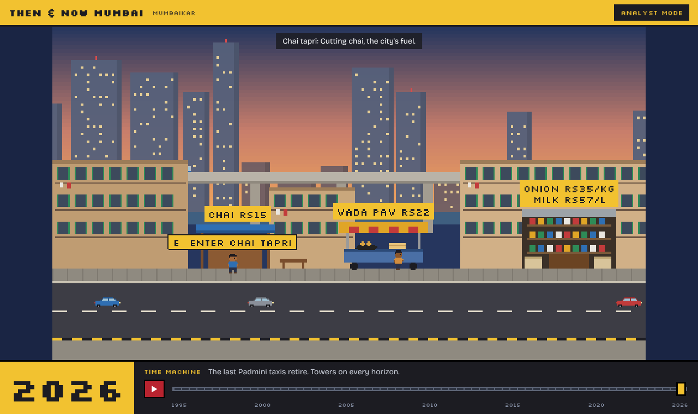
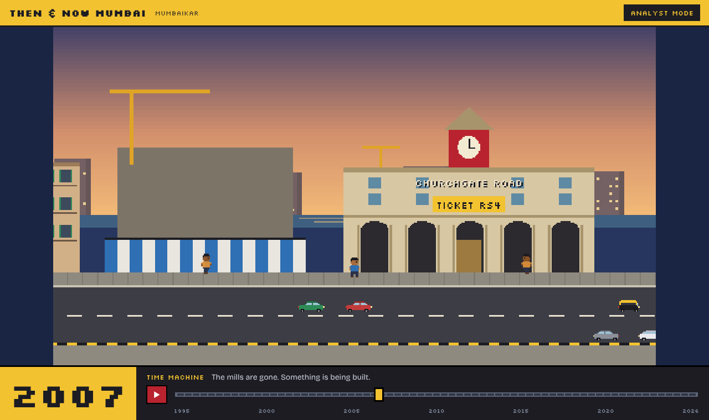
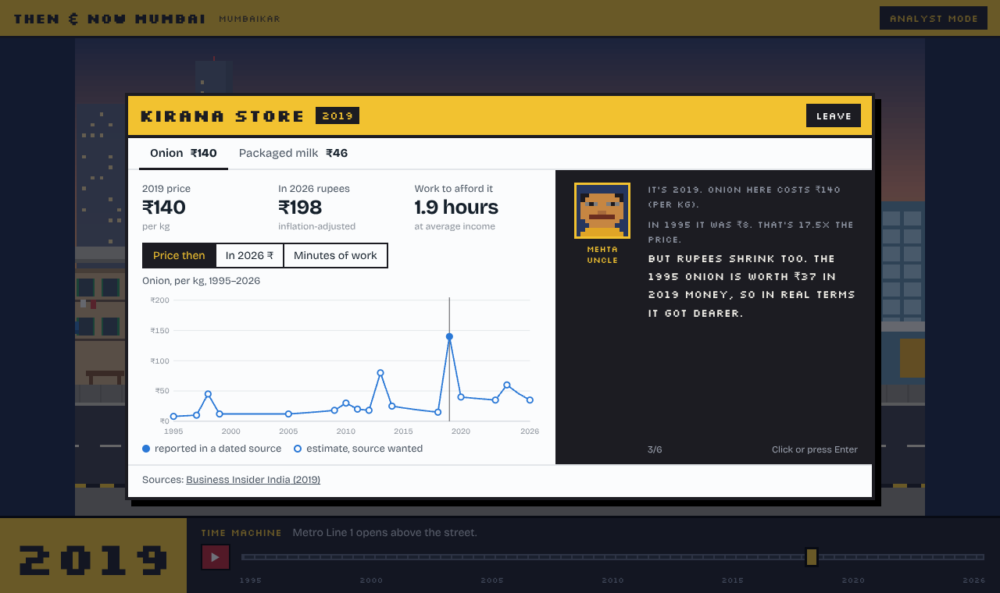
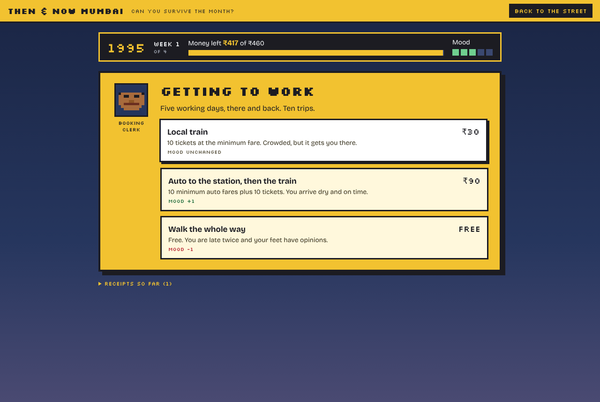
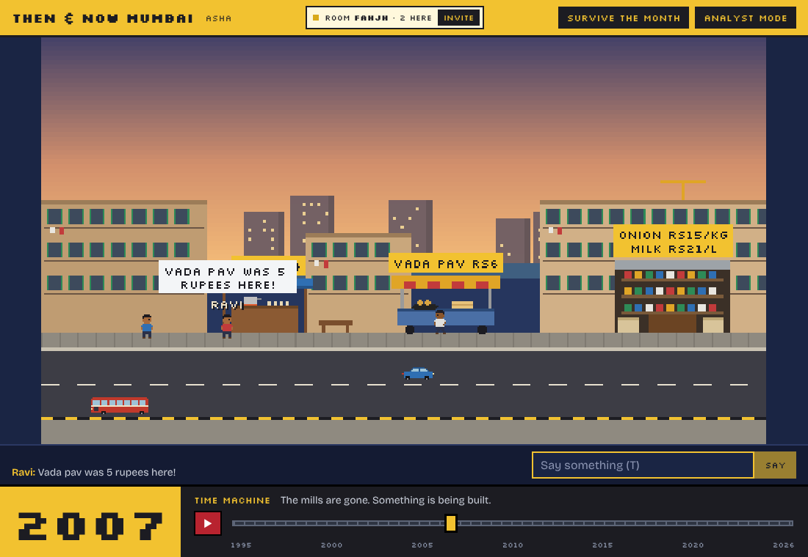
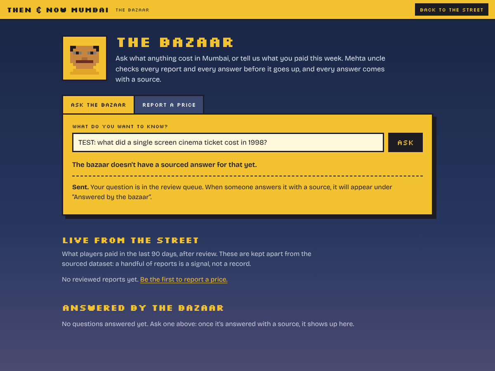
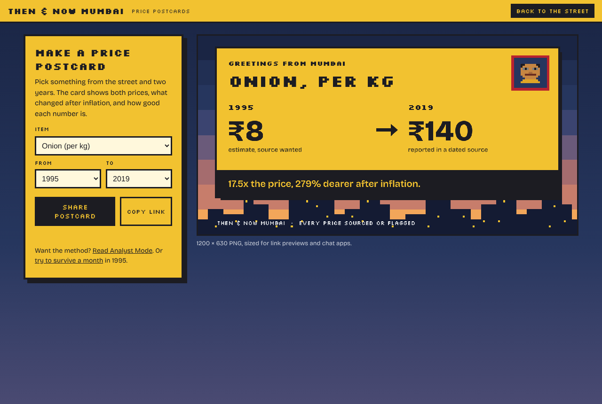
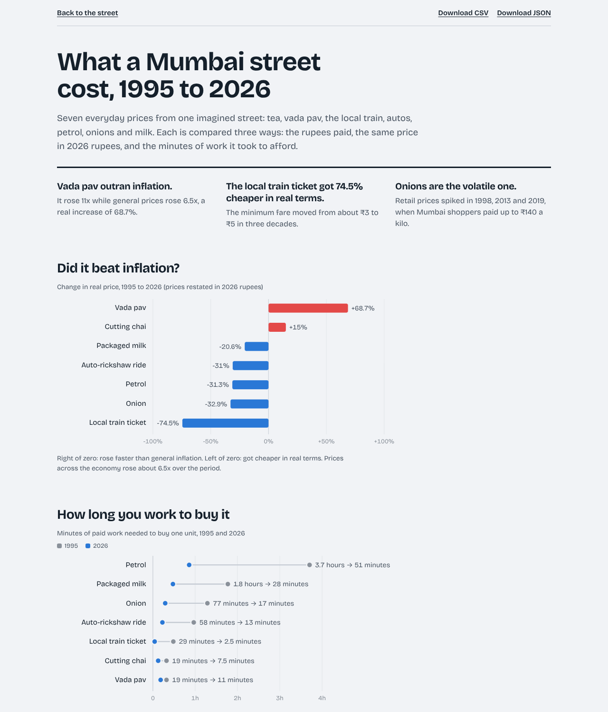

# Then & Now Mumbai

A pixel-art Mumbai street where every shop is a dataset. Walk into the chai tapri, the vada pav stall, the kirana store, the railway station or the auto stand, and the shopkeeper tells you what things cost, and what they cost in 1995. Drag the **Time Machine** and the whole street changes around you: mill chimneys give way to a construction crane and then a glass mall, towers rise on the skyline, Metro Line 1 appears overhead in 2014, and the Padmini taxis disappear in 2023.

Then try to **survive a month** in the year of your choice, and turn any price into a shareable **postcard**.

One button switches to **Analyst Mode**: a plain report with inflation-adjusted comparisons, a data-quality breakdown, the full method and every source.



| 2007: the market is gone, the mall is coming | Inside the kirana store during the 2019 onion crisis |
| --- | --- |
|  |  |

## Can you survive the month?

Four weeks of Mumbai street spending: the weekly kirana run, the commute, lunch, chai, and one curveball a week (a Sunday at Juhu, a monsoon evening, a friend's birthday). Run out of money or out of good mood and the month wins.

The budget is the same real money in every year: ₹3,000 in 2026 rupees, deflated with India's CPI. So the only thing that changes between years is street prices, and the game asks the project's question honestly: did they outrun inflation? At the end you see what your exact choices would have cost in 1995, 2005, 2015 and 2026.



## Walk the street with friends

On the start screen, choose **Start a room** to get an invite code and link (`/?room=K7QXM`), or type a friend's code to join. Up to 8 people share one street: you see each other walk, chat in speech bubbles (press T), and the **Time Machine is shared**, so when one person drags it to 1998 everybody's street changes and a note says who moved it. Players inside a shop fade out and their name tag says where they are.

There is no game server and no database. A room is a Supabase Realtime broadcast channel; each player sends their own position a few times a second and everyone draws everyone else. Incoming messages are validated and chat is plain text, one line, at most 80 characters. The project's Supabase settings live in the committed `.env` (they are public by design and end up in the browser bundle anyway; no tables or migrations are needed). To point at a different project, change these two values:

```bash
NEXT_PUBLIC_SUPABASE_URL=https://<project>.supabase.co
NEXT_PUBLIC_SUPABASE_PUBLISHABLE_KEY=sb_publishable_...
```

Without them, rooms still work between tabs of the same browser, which is handy for development.



## The bazaar

`/bazaar` has two halves, and nothing from either goes public until it has been reviewed.

- **Ask the bazaar.** Ask what anything cost in Mumbai. Questions about the seven street items are answered instantly from the dataset, with the figure's confidence and source. Anything else goes to a review queue, and is published only once a reviewer answers it with a price, a year and a source link. Answered questions are matched to new ones, so the same question gets the same sourced answer.
- **Report a price.** Tell the bazaar what you paid in the last two years for any of the seven items, with an optional neighbourhood and note. Reviewed reports appear as "Live from the street": the median of the last 90 days in each shop, on the bazaar page and in Analyst Mode. They are deliberately kept apart from the sourced dataset.

Reviewers use `/bazaar/review` with a review key. The key is checked by the database on every action and is stored there only as a bcrypt hash.

How it is protected (`supabase/migrations/*_bazaar.sql`):

- Row-level security: visitors can insert only a few named columns (new rows always start as pending) and can read only approved reports and answered questions. Nobody can update or delete except through the key-checked review functions.
- Rate limits per connection (a salted hash of the IP, in a private schema the API can't reach), a site-wide hourly cap, and caps on the size of the queue.
- Text is stripped of control and direction-override characters, and every field has a length limit.



## Price postcards

Pick any item and two years and get a 1200 × 630 PNG with both prices, the change after inflation, and the confidence of each number. Share it from your phone, download it, or copy a link like `/postcard/?item=onion&from=1995&to=2019`. Every shop has a "Make a postcard" link.



## What the data says (so far)

- **Vada pav outran inflation.** ₹2 to about ₹22: an 11x rise while general prices rose about 6.5x, a real increase of roughly 69%.
- **The local train got about 75% cheaper in real terms.** The minimum second-class fare moved from about ₹3 to ₹5 in three decades.
- **Onions are the volatile one.** Mumbai shoppers paid up to ₹140 a kilo in November 2019.
- Measured in minutes of work at Maharashtra's average income, everything got "cheaper". That average is pulled up by high earners, which is exactly the kind of caveat Analyst Mode spells out.



## Honest data

Street prices were never published as a series. Every price in this project is an **anchor** with a confidence level:

| Confidence | Meaning |
| --- | --- |
| documented | an official notice or primary record |
| reported | a dated news report states the figure |
| estimated | reconstructed, still needs a source (hollow dots in the charts) |
| interpolated | a year between anchors, filled log-linearly (the shopkeepers say so out loud) |

Right now the dataset has 17 sourced anchors and 58 estimates. Turning hollow dots into solid ones is the main data task ahead. Found an old price in a newspaper, a receipt or a fare chart? Open an issue with the source.

## How it's built

| Layer | Tech |
| --- | --- |
| Data pipeline | Python (`scripts/build_data.py`): anchors → interpolation → CPI adjustment → minutes of work |
| Website | Next.js 16 (static export), React 19, TypeScript |
| Pixel world | Phaser 4. Every sprite is a text grid painted in code, so there are no image assets |
| Charts | Hand-built SVG with hover tooltips, light and dark themes |
| Multiplayer | Supabase Realtime broadcast channels (no server, no database), BroadcastChannel fallback |
| Bazaar | Supabase Postgres with row-level security and key-checked review functions |

```
data/raw/anchors.csv     every price point, its confidence, source and note
data/raw/macro.csv       India CPI inflation + Maharashtra per capita income
data/raw/sources.csv     the source list
scripts/build_data.py    builds public/data/series.json and the CSV download
src/game/                Phaser scene and sprite textures
src/components/          street UI, shop panel, Time Machine, Analyst Mode, Survive, Postcard
src/lib/survive.ts       the month game's rules (pure functions, every price from the dataset)
src/lib/postcard.ts      draws the postcard PNG on a canvas
src/lib/room.ts          multiplayer rooms: transports, message validation, presence
src/lib/bazaar.ts        Ask the Bazaar + price reports: queries, dataset matching, report summaries
supabase/migrations/     database schema, row-level security and review functions
```

## Run it locally

```bash
npm install
npm run data     # rebuild the dataset from data/raw (Python 3, no extra packages)
npm run dev      # http://localhost:3000
npm run build    # static site in out/
```

Controls: arrow keys or A/D to walk, E (or Enter) to enter a shop, Esc to leave. On a phone, use the buttons under the street.

## Roadmap

1. **Phase 1 (done):** one street, five buildings, seven items, Time Machine, Analyst Mode.
2. **Phase 2 (done):** "Can you survive the month?" mini-game and shareable price postcards.
3. **Phase 3 (done):** multiplayer: walk the street with friends.
4. **Phase 4 (this release):** "Ask the Bazaar" (any item, with cited sources and a review queue) and live price reports from players.
5. **Next:** Claude drafts cited answers into the review queue, so reviewers check instead of research.

Shop names are generic and no brand logos are used. Facts are quoted from the linked sources; no article text is reproduced.
