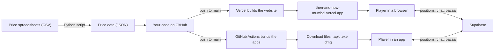

# Then & Now Mumbai: Project Handbook

Everything about the game: what it's made of, which languages and tools it uses, how each part works, how it goes live, and how to change it yourself.

- **Live site:** https://then-and-now-mumbai.vercel.app
- **Play straight away:** https://then-and-now-mumbai.vercel.app/play
- **Easy-words guide (PDF):** [Then-and-Now-Guide.pdf](Then-and-Now-Guide.pdf)

## Contents

1. [What you built](#1-what-you-built)
2. [The big picture](#2-the-big-picture)
3. [Programming languages](#3-programming-languages)
4. [Tools and services](#4-tools-and-services)
5. [Where everything lives](#5-where-everything-lives)
6. [How the game works](#6-how-the-game-works)
7. [How the prices work](#7-how-the-prices-work)
8. [Playing with friends](#8-playing-with-friends)
9. [The bazaar](#9-the-bazaar)
10. [The website and "install"](#10-the-website-and-install)
11. [The Mac, Windows and Android apps](#11-the-mac-windows-and-android-apps)
12. [How it goes live](#12-how-it-goes-live)
13. [How to do things](#13-how-to-do-things)
14. [What it costs](#14-what-it-costs)
15. [How it was built](#15-how-it-was-built)
16. [Glossary](#16-glossary)

---

## 1. What you built

**Then & Now** is a pixel-art game about Indian street prices. You fly over a Mumbai or Delhi neighbourhood from above, walk into the chai shop, the kirana and the railway station, and the shopkeepers tell you what things cost. Drag the **Time Machine** from 1995 to 2026 and the whole city changes: prices, vehicles, buildings, the Metro appearing overhead.

Around the game there is:

- **Analyst Mode**: charts of every price, with its source and how sure we are about it.
- **Survive the month**: a budget game. Can you get through four weeks of 1995 street spending?
- **Price postcards**: shareable images like "Onion, 1995 vs 2019".
- **Multiplayer**: up to 8 friends walk the same street, chat, and share one Time Machine.
- **The bazaar**: players ask about prices and report what they paid. A reviewer approves everything before it goes public.
- **Apps** for Android, Windows and Mac, plus "add to home screen" on iPhone.

Every price is either tied to a dated source (a fare notice, a news report) or openly marked as an estimate. That honesty rule runs through the whole project.

## 2. The big picture



> **In plain words:** the game itself is a set of files (pages, code, price data) that run entirely in the player's browser or app. There is no server of our own. Vercel hosts the files for free, GitHub stores the code and builds the apps, and Supabase handles the two things that need a shared place online: multiplayer rooms and the bazaar.

## 3. Programming languages

| Language | Share | What it does here |
| --- | --- | --- |
| **TypeScript** | ~80% | The game, the website, multiplayer, the bazaar. JavaScript with type checking, so mistakes show up before the code runs. |
| **CSS** | ~8% | How the website looks: colours, fonts, layout. |
| **Python** | small | Builds the price data from spreadsheets, and draws the app icons. |
| **SQL** | small | The bazaar's database: tables, security rules, review functions, nightly cleanup. |
| **JavaScript** | small | The offline helper (service worker) and the Mac/Windows app wrapper. |
| **YAML** | small | The instructions GitHub follows to build the three apps. |
| **Java** | tiny | One Android file that loads the right page inside the app. |
| **Gradle** | tiny | Android's build settings: version number, signing. |
| **CSV / JSON** | data | The price spreadsheets and the files the game reads. |

> **Why TypeScript:** browsers only run JavaScript. TypeScript is JavaScript with labels on every value ("this is a price in rupees", "this is a year"), which catches mistakes early. One language covers the game, the pages and the online features.

## 4. Tools and services

### Frameworks and libraries

| Tool | What it is | What it does here |
| --- | --- | --- |
| Next.js 16 | Website framework | Builds every page (home, play, analyst, bazaar, survive, postcard, privacy) into plain files that load fast |
| React 19 | UI library | All the buttons, panels, menus, charts and the Time Machine slider |
| Phaser 4 | 2D game engine | The city: drawing, camera and zoom, walking, collisions, traffic, trains |
| Supabase JS | Supabase's library | Talks to Supabase for rooms and the bazaar |
| Silkscreen, Bricolage Grotesque | Fonts | The pixel headline font and the readable body font |
| Electron | Desktop app shell | Turns the website into a real Mac and Windows app |
| electron-builder | Packager | Makes the `.dmg` (Mac) and `.exe` installer (Windows) |
| Capacitor 8 | Mobile app shell | Turns the website into an Android app (`.apk`) |
| Playwright | Browser robot | Testing: opens the game, walks around, takes screenshots, checks for errors |
| Pillow | Python image library | Draws the pixel-art icons at every size |

### Online services

| Service | What it does here | Plan |
| --- | --- | --- |
| GitHub | Stores all the code and its history. Shares download files through Releases. | Free |
| GitHub Actions | Borrows a Mac, a Windows PC and a Linux machine to build the three apps | Free |
| Vercel | Hosts the website and rebuilds it on every change | Free (Hobby) |
| Supabase | Live rooms for multiplayer, and the bazaar database | Free |

## 5. Where everything lives

```
then-and-now-mumbai/
├── src/
│   ├── app/            the pages: home, /play, /analyst, /bazaar, /survive, /postcard, /privacy
│   ├── components/     the screens and panels (Landing, Street, ShopPanel, Bazaar, Analyst…)
│   ├── game/
│   │   ├── art/        every sprite, drawn in code: people, vehicles, buildings, interiors
│   │   ├── world/      the maps of Mumbai and Delhi, shop interiors, who walks where
│   │   └── scenes/     the game logic: the city, inside a shop, controls and zoom
│   └── lib/            data, story lines, multiplayer, bazaar, postcards, survive rules
├── data/raw/           the price spreadsheets and the list of sources
├── scripts/            build_data.py (prices) and make_icons.py (icons)
├── public/             files served as-is: price data, icons, landing images, offline helper
├── supabase/           the bazaar database setup
├── desktop/            the Mac and Windows app
├── mobile/             the Android app
├── docs/               this handbook and the PDF guide
└── .github/workflows/  apps.yml: how GitHub builds the three apps
```

## 6. How the game works

**There are no image files in the game. Every pixel is drawn by code.**

### Pixel art drawn in code

Characters, taxis, BEST buses, chawls and trees are all painted by small functions in `src/game/art/`. A helper called the **painter** (`px.ts`) fills rectangles of colour on a hidden canvas and adds dark outlines around shapes. When the game starts, it paints every sprite once and hands the pictures to Phaser.

> **Why:** a taxi can change colour, a building can age between 1995 and 2026, and Delhi can get its own green CNG autos, all by changing a few lines of code instead of redrawing image files.

### The map

Each city is a grid of **104 × 72 tiles**, each tile 16 pixels square. Every tile is road, pavement, grass, water, rail or building. The map files (`src/game/world/mumbai.ts`, `src/game/world/delhi.ts`) list where everything stands: shops, trees, the station, bus stops, the sea.

### Scenes

- **City scene:** the drone view from above. Handles walking, the camera, zoom (scroll, pinch, + and −), traffic and doors.
- **Interior scene:** inside the chai shop, kirana or station. The station has trains that pull in, wait and leave.

### Traffic that behaves

Cars, buses and autos drive in lanes and **brake (and honk) when you are in front of them**. They never drive through you. Vehicles are clipped at the coastline so nothing appears out of the sea. The Metro viaduct fades when you walk under it, so it never hides you.

### The Time Machine

The year slider changes everything at once: the prices the shopkeepers quote, which vehicles exist (Padmini taxis retire in 2023, Delhi's Metro opens in 2002), and what the skyline looks like.

### Controls

Arrow keys or W A S D to walk, E or Enter to go into a shop, Esc to leave, T to chat. On a phone: a joystick, buttons and pinch to zoom.

## 7. How the prices work

1. **Anchors.** Each known price goes into a spreadsheet (`data/raw/anchors.csv`, and `data/raw/delhi/` for Delhi) with its year, the source, and a confidence level.
2. **Fill the gaps.** The Python script (`scripts/build_data.py`) fills the years in between on a smooth curve, so a price that goes ₹2 → ₹22 rises steadily rather than jumping.
3. **Adjust for inflation.** Using India's consumer price index, every price is also shown in 2026 rupees, so 1995 and 2026 can be compared fairly.
4. **Minutes of work.** Each price is also converted into how long an average earner in that state would work to pay it.
5. **Output.** The result is saved as `public/data/series.json` (Mumbai) and `public/data/series_delhi.json` (Delhi), which the game reads.

| Confidence | Meaning | Shown as |
| --- | --- | --- |
| documented | An official notice or primary record | Solid dot |
| reported | A dated news report gives the number | Solid dot |
| estimated | Reconstructed, still needs a source | Hollow dot |
| interpolated | A year between two known prices | The shopkeeper says so |
| unavailable | Didn't exist yet (Delhi Metro before 2002) | "Not open yet" |

Items: Mumbai has chai, vada pav, local train, auto, petrol, onion and milk. Delhi has chai, samosa, Metro, auto, petrol, onion and milk.

## 8. Playing with friends

When you start a room you get a 5-letter code and a link like `/play/?room=K7QXM&city=delhi`. Each room is a **Supabase Realtime broadcast channel**, a live radio frequency that everyone in the room listens to. A few times a second, each player sends where they are, which way they face and which scene they're in, and everyone draws everyone else.

- Up to 8 people per room.
- The Time Machine is shared: when one person moves it, everyone's city changes and a note says who did it.
- Chat is one line of plain text, at most 80 characters, and every incoming message is checked before it is used.
- Nothing is saved. When everyone leaves, the room is gone.

Code: `src/lib/room.ts`.

## 9. The bazaar

**Ask the bazaar** answers questions about the 7 street items straight from the dataset. Anything else goes into a review queue. **Report a price** lets players say what they paid recently. Approved reports show up as "Live from the street", kept separate from the sourced data.

How it's protected:

- **Row-level security:** the database itself decides who can read or write each row. Visitors can only add new pending items and read approved ones.
- **Review key:** approving or rejecting needs a secret key, which the database checks on every action. It stores only a scrambled (bcrypt) copy of the key.
- **Rate limits** per visitor and per hour across the whole site, plus size limits on every field.
- **Nightly cleanup:** a scheduled job (pg_cron, 03:17 IST) deletes the rate-limit records after a day.

Reviewers work at `/bazaar/review`. The database setup is in `supabase/migrations/`.

## 10. The website and "install"

The home page (`/`) is the landing page. It works out what device you're on and shows the right button: **Download for Android**, **Download for Windows**, **Download for Mac**, or **Download now** (add to home screen) on iPhone and Linux. After you click, a box shows the first-launch steps for that device.

The site is also a **Progressive Web App**, a website that can install like an app:

- `src/app/manifest.ts` gives the name, icon and colours used when it's installed.
- `public/sw.js` is the **service worker**, a small offline helper. It keeps copies of the game files, so after the first visit the game opens without internet.
- `src/components/Pwa.tsx` detects the device and shows the browser's own install prompt where there is one.

## 11. The Mac, Windows and Android apps

| App | Built with | File | Built on |
| --- | --- | --- | --- |
| Android | Capacitor | `Then-and-Now-android.apk` | GitHub's Linux machine |
| Windows | Electron | `Then-and-Now-Windows-Setup.exe` | GitHub's Windows machine |
| Mac | Electron | `Then-and-Now-mac.dmg` | GitHub's Mac |

Each app carries a full copy of the website inside it, so it plays offline from the very first launch. Multiplayer and the bazaar still go online.

- **Mac and Windows** (`desktop/main.js`): opens a window and serves the game from inside the app at a private address, `app://game`. Links to other sites open in your normal browser.
- **Android** (`mobile/`): Capacitor puts the game in a phone app. A small Java file makes sure `/play/`, `/bazaar/` and the other pages each load correctly.
- Inside any app, the home page skips straight to the game.

> **Why the warnings:** Apple, Microsoft and Google all charge to vouch for an app's maker. Without that, the first launch shows one warning: Mac "Open Anyway", Windows "More info → Run anyway", Android "install unknown apps". The landing page walks people through it.

## 12. How it goes live

1. Changes are made on a work branch and pushed to GitHub. Vercel makes a **preview copy** with a long address, for checking. Previews need a Vercel login.
2. When it's ready, the change goes onto `main`.
3. **Vercel** sees the new `main`, builds the site (about a minute) and puts it live at **then-and-now-mumbai.vercel.app**.
4. At the same time, **GitHub Actions** builds the three apps (about 5 minutes) and publishes them as the latest Release. The download buttons always point at the latest one.

## 13. How to do things

### Run it on your own computer

Install Node.js (version 22) and Python 3, then in the project folder:

```bash
npm install
npm run dev        # open http://localhost:3000
npm run build      # makes the finished site in out/
```

### Add or correct a price

1. Open `data/raw/anchors.csv` (or `data/raw/delhi/anchors.csv`) in any spreadsheet app.
2. Add a row: item, year, price, confidence (documented / reported / estimated), source and a note. Add the source to `data/raw/sources.csv`.
3. Run `npm run data`. It rebuilds the price files.
4. Push to `main`. The site and the apps update by themselves.

### Review bazaar questions and reports

Go to `/bazaar/review` on the live site and enter the review key. Approve, reject, or answer with a price, a year and a source link.

### Release a new version of the apps

Nothing to do: every change to the game on `main` rebuilds them. To rebuild by hand, go to the repository on GitHub → **Actions** → **Apps** → **Run workflow**.

### Make the Android signing key permanent

A new APK only installs over the old one if both were signed with the same key. GitHub made a key on the first build and keeps it in its cache, which it deletes after 7 days with no builds. To keep a key for good, make your own once on a computer with Java:

```bash
keytool -genkeypair -keystore release.keystore -alias thenandnow \
  -keyalg RSA -keysize 2048 -validity 10000
base64 -i release.keystore       # copy what this prints
```

Then on GitHub: **Settings → Secrets and variables → Actions → New repository secret**. Add `ANDROID_KEYSTORE_BASE64` (the printed text) and `ANDROID_KEYSTORE_PASSWORD` (the password you chose). Keep the keystore file somewhere safe. If you lose it, phones will have to uninstall the app before installing a new version.

### Use your own domain name

Buy a name (for example `thenandnow.in`), then in Vercel: **Project → Settings → Domains → Add**, and copy the DNS records Vercel shows into your domain seller's settings.

## 14. What it costs

**Free today:** website hosting (Vercel Hobby), code storage and app builds (GitHub, public repository), multiplayer and bazaar (Supabase free tier), the `.vercel.app` address, and all fonts and libraries (open source).

**Optional, costs money:**

| What | Cost |
| --- | --- |
| Google Play listing | $25 once |
| Apple Developer (Mac without warning, iPhone App Store) | $99 a year |
| Windows code-signing certificate | about $100–300 a year |
| Your own domain | about ₹500–1,000 a year |

Free-tier limits to watch: Supabase pauses a free project after a week with no activity (one click wakes it), and Vercel Hobby is meant for non-commercial projects.

## 15. How it was built

Built across 15–16 October 2026, in this order:

1. **Phase 1: one street.** Five shops, seven items, the Time Machine, Analyst Mode and the sourced price data.
2. **Phase 2: games and sharing.** Survive the month, and price postcards.
3. **Phase 3: multiplayer.** Rooms on Supabase Realtime, a shared Time Machine, chat bubbles.
4. **Live on Vercel.** The website deployed, updating from `main` on its own.
5. **Phase 4: the bazaar.** Questions, price reports, the review queue and its database security, then the nightly cleanup.
6. **The big redesign.** Drone view from above, zoom, walk-in shops and the station with trains, larger vehicles, softer art.
7. **Fixes and Delhi.** No more traffic from the sea or through the player. Delhi added with its own researched prices.
8. **Installable.** Landing page with Download now, offline support, icons.
9. **Real apps.** Mac app, then Windows and Android, all built automatically by GitHub.

## 16. Glossary

| Word | Meaning |
| --- | --- |
| Repository (repo) | The project folder on GitHub, with the full history of every change. |
| Commit | One saved change, with a message saying what it did. |
| Branch / main | A separate line of work. `main` is the one that goes live. |
| Push | Sending commits from a computer up to GitHub. |
| Deploy | Putting a new version live. |
| Static export | The website built into plain files, with no server code needed. |
| Sprite | One small picture in the game: a person, a taxi, a tree. |
| Tile | One 16×16 square of the map. |
| Scene | One part of the game Phaser runs: the city, or the inside of a shop. |
| Anchor | A price we have a source or estimate for, in a given year. |
| Interpolation | Filling in the years between two anchors. |
| CPI | Consumer price index, India's measure of general inflation. |
| PWA | Progressive Web App: a website that can be installed and work offline. |
| Service worker | A small script the browser keeps running to serve saved files offline. |
| Realtime channel | A live connection where everyone in a room hears every message. |
| Row-level security | Rules inside the database about who can see or change each row. |
| Release | A GitHub page holding the download files for one version. |
| APK / EXE / DMG | App files for Android, Windows and Mac. |
| Signing | A digital stamp proving who made an app and that nobody changed it. |
